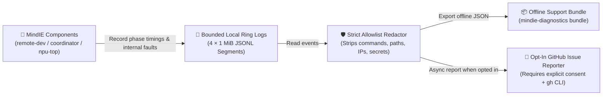

<h1 align="center">MindIE Agent Diagnostics (<code>mindie-diagnostics</code>)</h1>

<p align="center">
  <strong>Shared diagnostics and fault-reporting foundation for MindIE Agent — bounded local ring-buffer logs, one-command redacted support bundles, and opt-in GitHub Issue reporting that never leaks your code, commands, or secrets</strong>
</p>

<p align="center">
  
  
  
  <a href="./LICENSE"></a>
</p>

<p align="center">
  <a href="./README.md">中文</a> · <strong>English</strong> · <a href="#quick-start">Quick Start</a> · <a href="#real-world-usage-examples">Examples</a> · <a href="#python-integration">Python API</a> · <a href="./docs/README.en.md">Documentation</a> · <a href="https://github.com/mindie-agent/mindie-agent">MindIE Agent Main Repo</a>
</p>

---

## Why `mindie-diagnostics`?

When troubleshooting remote development tools (`remote-dev`, `coordinator`, `npu-top`, or client plugins), two problems usually get in the way:
1. **Unbounded or Missing Logs**: Standard log files either grow forever until they fill up your disk or lack structured phase timings when you actually need to debug a hang.
2. **Privacy Risk When Sharing Logs**: Raw logs often contain server IPs, file paths, shell commands, or environment variables that cannot be safely pasted into a public GitHub Issue.

`mindie-diagnostics` solves both problems across the entire MindIE Agent ecosystem:

- **100% Model-Free Execution**: Recording logs, rotating files, exporting bundles, and filing Issues are pure deterministic Python operations — **they never call an LLM, never read conversation transcripts, and never replay failed user commands.**
- **Bounded Ring-Buffer Logs That Never Fill Your Disk**: Each component writes to four fixed `1 MiB` JSONL segments per process (reusing a segment only after registered readers finish), with offline cleanup keeping each root within `7 days / 128 MiB / 512 files`.
- **Strict Allowlist Privacy**: Exported bundles and public GitHub Issues contain **only static component names, versions, operation stages, error categories, durations, exit codes, and internal product stack frames**. Your commands, source code, prompts, file paths, host IPs, and credentials are completely excluded.
- **Explicit Opt-In Issue Reporting**: Automatic GitHub Issue reporting is **off by default**. Turning it off immediately revokes any queued reports waiting to be sent.



---

## Quick Start

MindIE Agent plugins use one contribution choice per installation profile for
knowledge sharing and fault reporting. An explicit contribution choice links the
same consent authority, configures diagnostics, and starts the native worker.
Configuration alone does not mean that the worker is ready. Legacy choices
without `choice_revision` require an explicit unified choice before diagnostics
upload; an old reporting opt-out is never silently expanded. Profiles own separate
policies, queues, and workers. Temporary network or GitHub permission failures
retain evidence with backoff. An uncertain POST only reconciles remote markers
and never automatically creates another issue. The lower-level CLI below also
supports explicitly managed standalone components; plugins use their unified
contribution entrypoint.

### Option 1: One-Sentence Setup via Your AI Agent (Recommended)

Copy and paste this sentence to Claude Code, Codex, Kimi Code, or Cursor to let your agent install `mindie-diagnostics` and inspect local diagnostic status:

```text
Please install and configure https://github.com/mindie-agent/diagnostics for me
```

<details>
<summary>🤖 <b>Instructions for AI Agents (Auto-Install Protocol)</b></summary>

If you are an AI Agent receiving the prompt above, follow these steps to install and verify `mindie-diagnostics`:

1. **Install the Package**: Verify Python `>= 3.11` and install via `uv` (or `pip`):
   ```bash
   uv pip install git+https://github.com/mindie-agent/diagnostics@main
   ```
2. **Check Current Local Status (Read-Only)**:
   ```bash
   python3 -m mindie_diagnostics.cli reporting status
   ```
3. **Respect User Consent (Never Enable Reporting Without Explicit Permission)**:
   - Keep automatic reporting disabled (`--enabled false`) by default.
   - Only if the user explicitly asks to **enable automatic GitHub Issue reporting** (requires an authenticated `gh` CLI):
     ```bash
     python3 -m mindie_diagnostics.cli reporting configure --enabled true
     python3 -m mindie_diagnostics.cli reporting ensure
     ```
   - If the user asks to **export an offline redacted support bundle** for an `operation_id`:
     ```bash
     python3 -m mindie_diagnostics.cli bundle --root <log-root> --operation-id <OPERATION_ID>
     ```
4. **Report Back**: Show the user the output of `reporting status` and let them know how to export offline bundles or toggle opt-in reporting anytime.

</details>

### Option 2: One-Line Terminal Install for Humans

Requires Python `>= 3.11` (and an authenticated `gh` CLI if you choose to enable automatic GitHub Issue reporting):

```bash
# Install directly from Git
uv pip install git+https://github.com/mindie-agent/diagnostics@main

# Or install in editable mode from a local clone
git clone https://github.com/mindie-agent/diagnostics.git
cd diagnostics
uv pip install -e .
```

---

## Real-World Usage Examples

### Example 1: Export a redacted offline support bundle to attach to a bug report

Every `remote-dev` or `coordinator` response includes an `operation_id` inside `diagnostics`. Export a clean, redacted JSON bundle for that operation without touching the network:

```bash
python3 -m mindie_diagnostics.cli bundle --root /path/to/log-root --operation-id <OPERATION_ID>
```

### Example 2: Check local incident status or toggle opt-in GitHub Issue reporting

```bash
# 1. View recent local incidents, current consent state, queue size, and worker health
python3 -m mindie_diagnostics.cli reporting status

# 2. Opt in to automatic GitHub Issue reporting (defaults to mindie-agent/mindie-agent)
python3 -m mindie_diagnostics.cli reporting configure --enabled true
python3 -m mindie_diagnostics.cli reporting ensure

# 3. Turn off automatic reporting at any time (immediately cancels any unsent queue items)
python3 -m mindie_diagnostics.cli reporting configure --enabled false
```

### Example 3: Run offline log cleanup or upgrade a running background worker

```bash
# Prune logs older than 7 days or exceeding the 128 MiB cap
python3 -m mindie_diagnostics.cli reporting maintain

# Smoothly upgrade a healthy running worker to a newly installed version
python3 -m mindie_diagnostics.cli reporting maintain --update-running
```

---

## Python Integration (For MindIE Component Authors)

Record internal component failures at the boundary that owns the failure:

```python
from mindie_diagnostics.integration import record_failure

result = record_failure(
    "remote-dev",
    "mcp.request",
    stage="decode",
    category="protocol_mismatch",
    exception=error,
)
```

**Three Golden Rules for Component Integration:**
1. **Static Metadata Only**: Always pass fixed string literals for `category` and `operation` — **never pass user commands, paths, or dynamic input.**
2. **Caller Errors Are Not Product Bugs**: Bad user arguments, missing config files, SSH auth failures, or non-zero exit codes from user scripts should stay local (`reportable=False`) rather than opening product Issues.
3. **Structured Operation Timings**: Use `configure(...).operation(...)` to record stage durations and cleanup outcomes.

---

## NPU Profiling & Cross-Run Comparison (`mindie-profiler`)

Starting in `0.5.0`, this package also ships the `mindie-profiler` CLI (equivalent to `python3 -m mindie_profiler`) for in-place Ascend profiler accounting (`mindie-profile-summary/1` C7 JSON) and cross-run comparison:

```bash
# 1. Analyze an Ascend SQLite DB (or kernel_details.csv) in place with explicit labeled or unlabeled windows
mindie-profiler \
  --root /path/to/ascend_pytorch_profiler_dir \
  --step-window 1=100000:250000 \
  --time-window 260000:400000 \
  --unit us --source auto \
  --mode inference --framework vllm-ascend --phase decode --tp 8 \
  --input-signature "qwen2.5-7b-bs16-in1024-out128" \
  --output /tmp/baseline-c7.json

# 2. Compare two C7 summaries (or pass --{baseline,candidate}-root with --*-steps-file)
#    Exits 0 when comparable, or 3 when not_comparable (missing workload identity or incompatible scope)
mindie-profiler compare \
  --baseline-summary /tmp/baseline-c7.json \
  --candidate-summary /tmp/candidate-c7.json \
  --output /tmp/compare-receipt.json
```

**Scope & Limitations:**
- **In-Place SQLite Direct Read & Explicit Windows**: Reads `ascend_pytorch_profiler_*.db` (preferred by `--source auto`) or `kernel_details.csv` in place under bounded query timeouts (`--query-timeout-s`, default `20s`). Requires explicit `--step-window`, `--time-window`, `--steps-file`, or `--full-range` — **it never infers step IDs from kernel rows**. Unverified Wait-Anchor `wait_ns` and absent PMU counters are reported explicitly in `limitations`.
- **Dual Collection & Honest Outcome Accounting**: Supports explicit online HTTP profile-window control (single `POST /start_profile` and `POST /stop_profile` requests that distinguish `completed`, `failed`, and non-retried `unknown` outcomes) alongside offline `torch_npu.profiler` / `msprof` artifact analysis.
- **Model Provider (`TensorCastAnalyticProvider`)**: `mindie_profiler/tensor_cast_provider.py::TensorCastAnalyticProvider` invokes the pinned upstream `msmodeling` / `tensor_cast` (`0.2.0` / `1adde03`) `AnalyticPerformanceModel` and joins explicit operator `shapes`, `dtypes`, and `weights` with measured `TASK` durations (alongside `roofline-max-v1` local per-operator lower bounds). Limitations: the `Ascend910B4` to `ATLAS_800_A2_280T_32G_PCIE` hardware spec mapping remains marked `caller_explicit_unverified`, PMU data reports raw counters only without causal bottleneck attribution, and `Wait-Anchor` provenance remains unverified.
- **HBM Memory Attribution (`P0–P4`) Scope**: Performs tiered attribution over observed finite sampled peaks only; `P2` log values are rounded approximations, device and allocator reads are non-atomic, and **no continuous absolute device peak is claimed**.

---

## Configuration Reference

| Variable / Path | Default | Description |
| --- | --- | --- |
| `MINDIE_DIAGNOSTICS_CONFIG` | `~/.config/mindie-agent/diagnostics.json` (or `$XDG_CONFIG_HOME/mindie-agent/diagnostics.json`) | Reporting policy file path (outbox queue, receipts, health, and isolated worker runtime live beside this file) |
| `MINDIE_DIAGNOSTICS_ROOT` | User state directory | Root directory for local structured JSONL diagnostic logs |
| `MINDIE_LOG_LEVEL` | `INFO` | Log verbosity (`DEBUG` / `INFO` / `WARNING` / `ERROR`) |

---

## Documentation

| Topic | 中文 | English |
| --- | --- | --- |
| Documentation Index | [docs/README.md](./docs/README.md) | [docs/README.en.md](./docs/README.en.md) |
| Architecture, Privacy Allowlist & Log Rotation | [docs/architecture-and-privacy.md](./docs/architecture-and-privacy.md) | [docs/architecture-and-privacy.en.md](./docs/architecture-and-privacy.en.md) |

---

## Development & Testing

```bash
python3 -m pytest
```

---

## License

Released under the [MIT License](./LICENSE).
