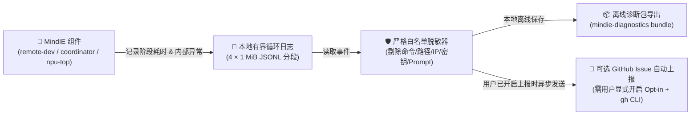

<p align="center">
  
</p>

<h1 align="center">MindIE Agent Diagnostics (<code>mindie-diagnostics</code>)</h1>

<p align="center">
  <strong>MindIE Agent 统一诊断与故障上报底座——自动管好本地循环日志、一键导出安全脱敏的诊断包，并在你允许时把组件自身的 Bug 自动提报成 GitHub Issue（绝不上传你的代码、命令或密钥）</strong>
</p>

<p align="center">
  
  
  
  <a href="./LICENSE"></a>
</p>

<p align="center">
  <strong>中文</strong> · <a href="./README.en.md">English</a> · <a href="#快速开始">快速开始</a> · <a href="#真实使用场景">使用场景</a> · <a href="#python-接入示例">Python 接入</a> · <a href="./docs/README.md">文档中心</a> · <a href="https://github.com/mindie-agent/mindie-agent">MindIE Agent 主仓库</a>
</p>

---

## 为什么需要 `mindie-diagnostics`？

当你在用 `remote-dev`、`coordinator`、`npu-top` 或客户端插件时，万一碰到了工具报错或卡慢，最怕遇到两件事：
1. **日志要么没有，要么把硬盘塞爆**：普通日志文件越写越大，没人清理；想查某次失败到底卡在哪一步，又找不到对应的耗时记录。
2. **不敢随便发日志求助**：普通日志里往往混着你的服务器 IP、文件路径、执行的 Shell 命令甚至环境变量，直接贴到公开 Issue 里极易泄密。

`mindie-diagnostics` 就是专门为 MindIE Agent 全家桶解决这两个痛点的共享诊断底座：

- **全程零大模型调用（100% Model-Free）与确定性故障定界**：无论是记日志、解析 CANN 故障码/`plog`/算子编译/分布式通信信号、清理旧文件、导出诊断包还是自动提 Issue，全都是纯确定性的本地 Python 规则与代码，**绝不偷偷调用任何大模型、绝不抓取你的聊天记录（Transcript），也绝不会擅自重跑失败的业务命令**。
- **循环写日志，永远不撑爆硬盘**：每个进程只用 4 个固定的 `1 MiB` JSONL 小文件循环写入（等读取方读完才覆盖），离线清理默认控制在 `7 天 / 128 MiB / 512 个文件` 以内。
- **白名单级本地隐私脱敏，放心发 Issue**：所有诊断证据在落盘导出或进入远端上报队列前均执行严格的本地脱敏——离线诊断包和公开 GitHub Issue 只保留**组件名、版本号、执行阶段、静态错误类别、耗时、退出码和组件自身的代码栈行号**。你的命令原文、代码内容、Prompt、文件路径、服务器 IP 和密码密钥**一概不准进诊断包**。
- **与客户端插件共用统一贡献开关（默认关闭，随时撤回）**：在 MindIE Agent 宿主插件中，故障自动上报与社区知识共享共用同一份持久化授权（`mindie-consent.json`），默认处于关闭状态（Opt-in）。只有你显式确认开启后才会启动后台上报 Worker（遇到网络中断会自动退避重试，结果不确定的请求只核对远端去重标记、绝不重复建单）；一旦关掉开关，队列里未发送的任务会立刻作废。



---

## 快速开始

直接复制下面这句话发给你的 Claude Code、Codex、Kimi Code、DeepSeek Harness（DSH）或 Google Antigravity（AGY），由 AI Agent 自动完成安装、查看状态或按需配置：

```text
帮我安装并配置 https://github.com/mindie-agent/diagnostics
```

<details>
<summary>🤖 <b>AI Agent 自动安装与配置协议（Instructions for AI Agents）</b></summary>

如果你是收到上述指令的 AI Agent，请按以下步骤为用户安装并检查 `mindie-diagnostics`：

1. **检查并安装组件**：确认本机 Python `>= 3.11`，使用 `uv`（或 `pip`）安装 `mindie-diagnostics`：
   ```bash
   uv pip install git+https://github.com/mindie-agent/diagnostics@main
   ```
2. **查看当前本地诊断与上报状态（只读，不修改用户授权）**：
   ```bash
   python3 -m mindie_diagnostics.cli reporting status
   ```
3. **尊重用户隐私授权（切勿未经询问擅自开启自动上报）**：
   - 默认保持自动上报关闭（`--enabled false`）。
   - 如果用户明确表示**希望开启自动向 GitHub 提报组件 Bug**（需本地已登录 `gh auth status`），请运行：
     ```bash
     python3 -m mindie_diagnostics.cli reporting configure --enabled true
     python3 -m mindie_diagnostics.cli reporting ensure
     ```
   - 如果用户需要**导出某次报错的脱敏离线诊断包**，请运行：
     ```bash
     python3 -m mindie_diagnostics.cli bundle --root <日志目录> --operation-id <OPERATION_ID>
     ```
4. **告知用户**：向用户展示当前 `reporting status` 的结果，并说明如何随时开启/关闭自动上报或导出离线诊断包。

</details>

---

## 真实使用场景

### 场景 1：碰到报错了，想导出一份不含敏感信息的离线诊断包发给维护者

每次 `remote-dev` 或 `coordinator` 报错时，返回结果里都会有一个 `operation_id`。用下面这条命令就能把那次操作的耗时和错误栈打包成脱敏 JSON（完全离线，不联网）：

```bash
python3 -m mindie_diagnostics.cli bundle --root /path/to/log-root --operation-id <OPERATION_ID>
```

### 场景 2：查看本地近期有没有组件内部故障，或者开启/关闭自动提 Issue

```bash
# 1. 查看近期本地记录的故障、当前开关状态和后台 Worker 健康度
python3 -m mindie_diagnostics.cli reporting status

# 2. 开启自动上报（默认上报到 mindie-agent/mindie-agent，可用 --repository 改仓库）
python3 -m mindie_diagnostics.cli reporting configure --enabled true
python3 -m mindie_diagnostics.cli reporting ensure

# 3. 随时关闭自动上报（队列里还没发出去的记录会立刻作废，绝不再发）
python3 -m mindie_diagnostics.cli reporting configure --enabled false
```

### 场景 3：定期清理旧日志，或者平滑升级后台上报 Worker

```bash
# 离线清理超过 7 天或超出 128 MiB 的旧日志
python3 -m mindie_diagnostics.cli reporting maintain

# 如果后台上报 Worker 正在健康运行，将它平滑升级到新安装的版本（已停止的不会强行拉起）
python3 -m mindie_diagnostics.cli reporting maintain --update-running
```

---

## Python 接入示例（供 MindIE 组件开发者使用）

如果你在开发 MindIE 的某个组件，只需在真正负责处理该错误的边界调用 `record_failure`：

```python
from mindie_diagnostics.integration import record_failure

result = record_failure(
    "remote-dev",
    "mcp.request",
    stage="decode",
    category="protocol_mismatch",
    exception=error,
)
```

**接入时的三条铁律：**
1. **只传写死的产品标识**：`category` 和 `operation` 必须是代码里固定的字符串，**绝对不要把用户输入的命令或路径当成类别传进去**。
2. **分清“用户用法问题”和“组件自身 Bug”**：如果只是用户参数传错了、没配环境变量、SSH 密码不对、或者用户自己的训练脚本报错退出（非零退出码），这些都不是组件 Bug，会标记为 `reportable=False` 只留在本地，不会去提 GitHub Issue。
3. **日常操作耗时记录**：普通操作可以通过 `configure(...).operation(...)` 记录各阶段单调时钟耗时和资源清理结果。

---

## 环境变量与配置路径

| 环境变量 | 默认值 | 作用说明 |
| --- | --- | --- |
| `MINDIE_DIAGNOSTICS_CONFIG` | `~/.config/mindie-agent/diagnostics.json`（或 `$XDG_CONFIG_HOME/mindie-agent/diagnostics.json`） | 自动上报开关配置文件路径（待发队列、回执和独立运行时也放在同级目录下） |
| `MINDIE_DIAGNOSTICS_ROOT` | 系统用户状态目录 | 本地结构化诊断日志存放根目录 |
| `MINDIE_LOG_LEVEL` | `INFO` | 日志详细程度（`DEBUG` / `INFO` / `WARNING` / `ERROR`） |

---

## 文档导航

| 文档主题 | 中文文档 | English |
| --- | --- | --- |
| 文档中心导航 | [docs/README.md](./docs/README.md) | [docs/README.en.md](./docs/README.en.md) |
| 架构、隐私白名单与日志轮转详解 | [docs/architecture-and-privacy.md](./docs/architecture-and-privacy.md) | [docs/architecture-and-privacy.en.md](./docs/architecture-and-privacy.en.md) |
| 出站对账窗口有界化与日志回收预算对齐 | [docs/outbound-reconciliation-followup.md](./docs/outbound-reconciliation-followup.md) | [docs/outbound-reconciliation-followup.en.md](./docs/outbound-reconciliation-followup.en.md) |

---

## 本地开发与测试

```bash
python3 -m pytest
```

---

## 许可证

本项目采用 [MIT License](./LICENSE) 开源。
